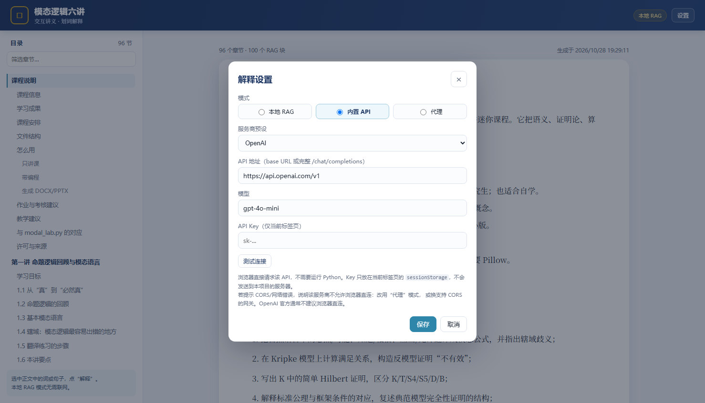

# 模态逻辑六讲 · 交互讲义

把 6 讲模态逻辑教学 DOCX 变成一个可交互网页：

- 左侧目录（H1–H3，可筛选、滚动高亮）
- 右侧正文（标题、段落、表格、代码块）
- 选中正文中的词/句，点“解释”
- 默认 **本地 RAG**（离线，BM25 检索 + 抽取式回答）
- 可选 **内置 API**（网页里填服务商/模型/Key，浏览器直接调用，不需要 Python）
- 可选 **代理**（Key 在服务端，适合线上/团队使用）



> 在线版：<https://harbourzhang167-alt.github.io/modal-logic-reader/>  
> 页面截图：[reader/screenshot-panel.png](reader/screenshot-panel.png)

## 直接使用

```powershell
# 方式一：直接打开静态页面（本地 RAG，无需联网）
start reader/index.html

# 方式二：本地服务（可选；代理模式需要）
python reader/serve.py --port 8010
```

打开 <http://127.0.0.1:8010/>。

### 接 API

**方式 A：内置 API（不需要 Python）**

页面右上角“设置” → 模式 **内置 API**：

1. 选服务商预设（OpenAI / DeepSeek / OpenRouter / SiliconFlow / 自定义）；
2. 确认 API 地址与模型；
3. 填 API Key（仅当前标签页 `sessionStorage`）；
4. 点“测试连接”；
5. 保存。

之后划词解释时，浏览器会直接调用该 OpenAI 兼容接口，不需要本地服务器。  
浏览器直连受 **CORS** 限制；若提示 CORS/网络错误，改用方式 B，或换支持浏览器跨域的网关。

**方式 B：代理（Key 在服务端）**

```powershell
$env:READER_API_KEY = "sk-..."
$env:READER_API_BASE = "https://api.openai.com/v1"   # 任意 OpenAI 兼容地址
$env:READER_MODEL = "gpt-4o-mini"
python reader/serve.py --port 8010
```

页面右上角“设置” → 模式 **代理** → 地址保持 `/api/explain` → 保存。  
API Key 只保存在服务端。GitHub Pages 是静态站，线上使用代理模式时需要一个远程代理。

## 本地 RAG 与 RAG 文档

这个仓库**有意提交**了生成后的 RAG 数据和前端产物，这样 GitHub Pages 不需要构建步骤即可直接运行：

| 文件 | 说明 |
|---|---|
| `reader/rag/modal-logic-rag.jsonl` | 标准 RAG 文档，100 个块，每行一个 JSON |
| `reader/rag/stats.json` | 96 个标题、100 个块、约 6.5 万字符 |
| `reader/rag.js` | 浏览器加载的同一份 RAG 数据 |
| `reader/content.js` | DOCX 转换后的 HTML 与统计信息 |

重新生成（需要 Python 3.10+ 与 `python-docx`）：

```powershell
pip install python-docx
python reader/build_reader.py
```

脚本会读取 `course/模态逻辑六讲讲义.docx`，同时更新 `reader/content.js`、`reader/rag.js` 和 `reader/rag/*`。  
生成文件不要手改；如需更新内容，改 DOCX 后重新运行脚本。

## 目录结构

```text
.
├── index.html                     GitHub Pages 根入口（跳转到 reader/）
├── reader/
│   ├── index.html                 阅读器
│   ├── style.css / app.js         布局、目录、划词、面板
│   ├── explain.js                 BM25 检索、抽取式回答、API
│   ├── content.js                 生成的正文
│   ├── rag.js                     生成的 RAG 数据
│   ├── rag/modal-logic-rag.jsonl  标准 RAG 文档
│   ├── build_reader.py            DOCX → HTML + RAG
│   ├── serve.py                   静态服务 + API 代理
│   └── tests/                     RAG 与 UI 冒烟测试
├── course/模态逻辑六讲讲义.docx      内容源
└── modal_lab.py                   讲义中引用的 Python 示例库
```

## 测试

```powershell
# RAG 检索、抽取式回答、anchor 一致性
node reader/tests/test_rag.js

# 页面、目录、划词、面板、设置（headless Chrome）
node reader/tests/ui_smoke.js
```

API 模式可以用 mock OpenAI 服务验证，不需要真实 Key。

**内置 API 直连测试（不经过 reader 代理）：**

```powershell
# 终端 1：CORS mock
python reader/tests/mock_api.py

# 终端 2：静态 reader
python reader/serve.py --port 8013

# 终端 3
node reader/tests/ui_direct_api_smoke.js
```

**代理模式测试：**

```powershell
# 终端 1：mock
python reader/tests/mock_api.py

# 终端 2：代理指向 mock
$env:READER_API_BASE = "http://127.0.0.1:8012/v1"
$env:READER_API_KEY = "test"
$env:READER_MODEL = "mock"
python reader/serve.py --port 8013

# 终端 3
node reader/tests/ui_api_smoke.js
```

`ui_smoke.js` 需要本机 Chrome；脚本里的路径按需修改。

## 部署到 GitHub Pages

仓库已包含 `.github/workflows/pages.yml`。首次部署：

1. 把仓库推到 GitHub；
2. 打开仓库 **Settings → Pages**；
3. **Build and deployment → Source** 选 **GitHub Actions**；
4. 向 `main` 推送，或在 **Actions** 里手动运行 `Deploy reader to GitHub Pages`；
5. 部署完成后访问 `https://<user>.github.io/<repo>/`，根入口会跳到 `reader/`。

如果不用 Actions，也可以把 Pages 的 Source 设为 `Deploy from a branch`，分支 `main`、目录 `/ (root)`；根 `index.html` 同样会跳转。`.nojekyll` 已就位。

## 说明与边界

- 本地 RAG 是**检索 + 抽取**，不是生成式模型；它不会编造，但语言不如 LLM 流畅。
- 内置 API 的质量取决于模型和 Prompt，且受服务商 **CORS** 策略影响；直连失败时改用代理或支持 CORS 的网关。
- `serve.py` 的代理模式只做转发。
- 公式以 Unicode 文本呈现，没有接 KaTeX/MathJax。
- 没有账号、没有云端存储；设置保存在浏览器 localStorage，API Key 在 sessionStorage 或服务端环境变量。
- DOCX 更新后需要重新运行 `reader/build_reader.py`，并提交生成文件。

## 致谢

内容参考了 SEP、Open Logic Project / *Boxes and Diamonds*、Isabelle AFP、QMLTP 等公开资料；具体链接与许可见讲义正文和调研报告。

## License

本仓库暂未附 License。发布前如需开源许可，建议代码使用 MIT、讲义内容使用 CC BY 4.0；请按你的意愿添加 `LICENSE`。
