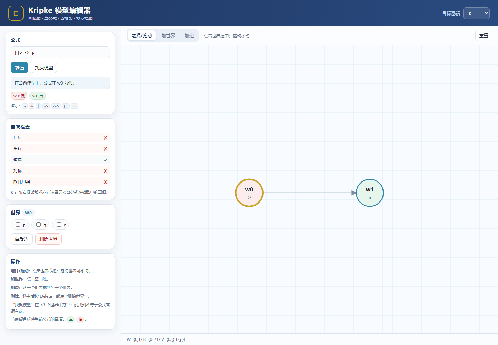

# Kripke 实验室

一个零依赖的浏览器工具：画 Kripke 模型、给世界赋值、计算公式、检查框架性质、在 ≤3 个世界中搜索反模型。



## 运行

直接双击 `index.html` 即可；它是纯静态页面，不需要后端。

如果浏览器对 `file://` 的脚本有限制，可以在工作区根目录运行：

```powershell
python -m http.server 8000
```

然后打开 <http://127.0.0.1:8000/reader/lab/index.html>。

## 功能

- **建图**：加世界、拖动布局、从一个世界拖到另一个世界加边、自反边、删除世界/边。
- **赋值**：选中世界后勾选 `p, q, r, ...`；公式中出现的原子会自动加入面板。
- **求值**：输入公式，显示每个世界的真值；节点变绿/红。
- **框架检查**：实时检查自反、串行、传递、对称、欧几里得；显示当前模型是否满足目标逻辑的框架条件。
- **反模型搜索**：在 K/T/K4/S4/S5/D/B/K5/KD45 的框架类中，穷举 ≤3 个世界的反模型；找到后自动替换模型并标出失败世界。
- **离线**：没有网络请求、没有第三方依赖、没有数据上传。

## 公式语法

| 写法 | 含义 |
|---|---|
| `p`, `q`, `r` | 原子命题 |
| `~A` | 否定 |
| `A & B` | 合取 |
| `A | B` | 析取 |
| `A -> B` | 蕴涵（右结合） |
| `A <-> B` | 等价 |
| `[]A` | 必然 |
| `<>A` | 可能 |
| `(A)` | 分组 |

优先级从低到高：`<->`、`->`、`|`、`&`、`~`/`[]`/`<>`。

示例：

```text
[]p -> p
[](p -> q) -> ([]p -> []q)
<>p -> []<>p
[](p & q) -> ([]p & []q)
```

## 目标逻辑与框架条件

| 逻辑 | 条件 |
|---|---|
| K | 无 |
| T | 自反 |
| K4 | 传递 |
| S4 | 自反 + 传递 |
| S5 | 自反 + 传递 + 对称 |
| D | 串行 |
| B | 自反 + 对称 |
| K5 | 欧几里得 |
| KD45 | 串行 + 传递 + 欧几里得 |

“框架检查”只检查**当前模型**的关系是否满足这些条件，不是在证明公式有效。

## 反模型搜索的边界

搜索在 `n = 1, 2, 3` 个世界上穷举：

- 找到反模型：结论可靠（模型确实满足该逻辑的框架条件，公式确实在某世界为假）。
- 没找到：只说明“≤3 个世界内没有反模型”，**不是**普遍有效性证明。

搜索最多支持 4 个原子命题；超过会提示。

## 操作

| 操作 | 方式 |
|---|---|
| 选择世界 | 点击节点 |
| 移动世界 | 拖动节点 |
| 加世界 | 切到“加世界”，点空白处 |
| 加边 | 切到“加边”，从源节点拖到目标节点 |
| 自反边 | 选中世界，点“自反边” |
| 删除边/世界 | 选中后按 `Delete`；或点“删除世界” |
| 取消选择 | 点空白处，或按 `Esc` |
| 求值 | 点“求值”，或在输入框按 Enter |
| 找反模型 | 点“找反模型” |

## 测试

核心逻辑（解析、求值、框架性质、反模型搜索）：

```powershell
node tests/test_core.js
```

浏览器 UI 冒烟测试（需要本机 Chrome；脚本会启动 headless Chrome）：

```powershell
node tests/ui_smoke.js
```

`ui_smoke.js` 里的 Chrome 路径是：

```js
const CHROME = "C:\\Program Files\\Google\\Chrome\\Application\\chrome.exe";
```

如果本机路径不同，改这一行即可。

测试覆盖：

- `[]p -> p` 在 K 中找反模型（1 个世界）；
- `[]p -> [][]p` 在 T 中找反模型（3 个世界）；
- `[]p -> p` 在 T 中 ≤3 世界无反模型；
- 求值 chips、框架性质列表；
- “加世界”交互。

## 文件结构

```text
app/
├── index.html          页面结构
├── style.css           样式
├── core.js             解析器、语义、框架检查、反模型搜索（UMD）
├── app.js              SVG 图编辑器与 UI 事件
├── screenshot.png      界面截图
└── tests/
    ├── test_core.js    Node 核心测试
    └── ui_smoke.js     headless Chrome UI 冒烟测试
```

`core.js` 既可以在浏览器里用 `window.ModalCore`，也可以在 Node 里 `require("./core.js")`。

## 与 Python 版的关系

`app/core.js` 与工作区根目录的 `modal_lab.py` 是同一套语义的两种实现：

- Python 版更适合批量实验、证明检查和教学脚本；
- JS 版更适合交互式建图和即时反馈。

两者在核心公式上做了交叉核对（`[]p -> p`、`4`、`5`、`B`、`D` 的反模型/有效性结果一致）。

## 已知限制

- 没有证明搜索（tableau/sequent）；只有“求值 + 有界反模型”。
- 没有保存/加载模型；刷新页面会重置。
- 没有多模态/多主体算子（`K_a`、`K_b`）；可以用 `[]` 表示单主体。
- 没有撤销/重做。
- 大模型（很多世界/原子）下反模型搜索会变慢。

这些都可以作为下一步扩展。
